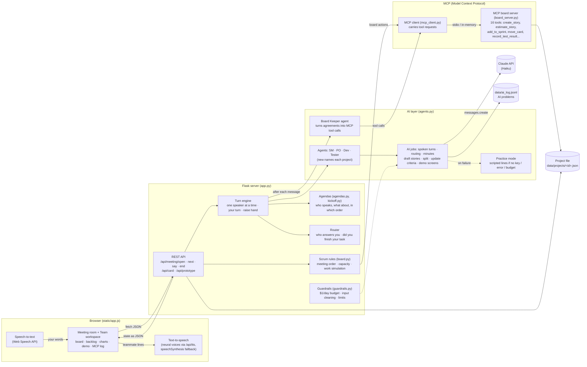
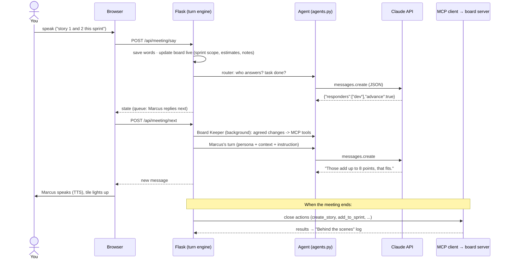

# Scrum Simu – Architecture

Scrum Simu is a browser-based Scrum simulator. You play the Product Owner or the Scrum Master, and AI agents (Claude) play the rest of the team (Developer, Tester and the other lead role). You run real meetings by voice, then watch the board, charts and demo change.

---

## 1. Block diagram



**Plain-text version** (for viewers that don't draw Mermaid):

```
 ┌──────────────────────── BROWSER ────────────────────────┐
 │  Mic (speech-to-text) ─► Meeting room / Workspace UI ─► Speakers (text-to-speech)
 └───────────────────────────────┬─────────────────────────┘
                                 │ REST / JSON
 ┌───────────────────────── FLASK SERVER ──────────────────┐
 │  API ─► Turn engine ─► Agenda + Router                   │
 │   │          │                                           │
 │   │          └─► AI agents (Sam, Priya, Marcus, Ana) ──► Claude API
 │   │                    └─ fallback: practice scripts     │
 │   └─► Scrum rules / work simulator                       │
 │              │ board actions                             │
 │              ▼                                           │
 │        MCP client ──(stdio)──► MCP board server ─► project JSON file
 │  Guardrails: $1/day budget, limits, input cleaning       │
 └──────────────────────────────────────────────────────────┘
```

---

## 2. Key components

| Component | File | What it does |
|---|---|---|
| **Web UI** | `static/index.html`, `app.js`, `style.css` | The meeting room (tiles, captions, Talk / Raise hand / End) and the team workspace (board, backlog, charts, demo, "Behind the scenes" MCP log). No framework: plain JavaScript. |
| **Voice** | `app.js`, `/api/tts` | Speech-to-text uses the browser's Web Speech API and keeps listening until "Done talking". Text-to-speech uses neural voices (edge-tts, served by `/api/tts`), falling back to the browser's `speechSynthesis`. One speaker at a time; captions appear word by word in step with the voice. |
| **REST API** | `app.py` | Flask endpoints. Each `/api/meeting/next` call returns after exactly one person has spoken, or when it's your turn. While a line is being spoken, the server already writes the next teammate's line, so turns follow quickly. |
| **Turn engine** | `app.py` | Runs the agenda as a queue. It hands you the turn (`awaiting`) and puts replies to your words at the front of the queue. When someone is asked a question by name, they answer next. It also runs the "Anything else?" loop before closing. |
| **Agendas** | `agendas.py`, `kickoff.py` | Steps for each ceremony: kickoff, refinement (story by story), planning, daily, review, and retro. Each step says who speaks and what about. |
| **Router** | `agents.py` (`ai_route`) | After you speak, Claude decides who should answer and whether you actually did your task. There's a rule-based fallback. |
| **AI agents** | `agents.py` | The AI personas (new names each project). Each turn is one Claude call that gets the context: product, board, transcript, and earlier meetings' minutes ("team memory"). |
| **Board Keeper** | `agents.py` (`ai_board_keeper`) | After each message, a separate agent decides whether the team *agreed* on a board change and makes it with MCP tools (estimate, add to sprint, update criteria, log bug, accept...). It runs in the background so the next speaker isn't delayed. |
| **AI jobs** | `agents.py` | Draft the backlog from the vision, split stories, fold discussion into acceptance criteria, write meeting minutes, and draw demo screens. |
| **Scrum rules + simulator** | `board.py` | Which meeting is allowed next, the capacity estimate (16 points in Sprint 1, then the average velocity of the last 3 sprints; a guide the PO may exceed), velocity, carry-over of unfinished work to the next sprint, and burndown/burn-up. Between meetings it simulates a "day" of AI dev/tester work. It never does *your* role's work. |
| **MCP client** | `mcp_client.py` | Opens a session to the board server and sends tool calls. |
| **MCP server** | `board_server.py` | FastMCP server with 16 board tools. It is the **only** part that changes the board, and every call shows in "Behind the scenes". |
| **Guardrails** | `guardrails.py` | Daily $ budget, a message limit per meeting, input cleaning, and a project limit on the public site. |
| **Storage** | `data/` | One JSON file per project, a usage file for the budget, and `ai_log.jsonl` for diagnosing AI problems. |
| **Hosting** | `passenger_wsgi.py` | Runs under cPanel/Passenger. Locally it runs with `python app.py`. |

---

## 3. One turn, end to end



---

## 4. Design choices (and why)

- **Rules in code, words from AI.** Scrum rules (meeting order, capacity estimate, carry-over, Done only after a passed test) are fixed in code, so the game stays correct. Claude supplies what people *say*.
- **MCP as the only way to change the board.** Agents and the simulator ask, and the board server does the work. This shows the real MCP pattern: client ↔ server, with tools and a log.
- **Graceful fallback.** If there's no API key, the budget is used up, or Claude errors, scripted lines keep the meeting going. Problems are logged, not hidden.
- **Cheap and fast.** Haiku, short replies, thinking switched off, and a $1/day cap.
- **One speaker at a time.** The browser asks for exactly one turn at a time, so it feels like a real call.

---

## 5. Tech stack

Python 3 · Flask · Anthropic SDK (Claude Haiku) · MCP Python SDK (FastMCP, stdio transport) · Web Speech API (speech-to-text) · edge-tts neural voices + speechSynthesis fallback (text-to-speech) · plain HTML/CSS/JS · hand-drawn SVG charts · JSON file storage · cPanel/Passenger hosting.

---

## 6. Possible next steps (newer topics not yet in the app)

| Topic | What it would add |
|---|---|
| **Speaking agents using tools directly** | Today the Board Keeper agent makes board changes with MCP tools after each message. Letting the speaking teammates call tools themselves mid-sentence would be the next step in agentic tool use. |
| **Remote MCP (Streamable HTTP + OAuth)** | The board server runs as a web service other AI clients can connect to, not just as a local process. |
| **MCP resources & prompts** | Expose the board as a *resource* and the meeting scripts as *prompts*, not only as tools. |
| **Structured outputs** | JSON-schema-checked answers for routing and story drafting, so there's no more "bad JSON". |
| **Streaming + prompt caching** | Teammates start talking sooner, and repeated context costs less. |
| **Realtime voice (speech-to-speech)** | More natural voices and interruptions than the browser's built-in voices. |
| **Evals & tracing** | Automatic checks that agents stay in role and answer the question asked, plus a trace view of each AI call. |
| **Multi-agent orchestration (e.g. Claude Agent SDK, A2A)** | Agents talk and hand off work directly, with an orchestrator, not a fixed agenda. |
| **RAG / long-term memory** | Agents search past meetings and documents (e.g. vector search), beyond the last few minutes. |
